# SFMC UX Tools

A Chrome extension with usability helpers for Salesforce Marketing Cloud Engagement, and for the content editor of Marketing Cloud Next.

Brought to you by Jörn Berkefeld, the developer behind [SFMC DevTools (mcdev)](https://github.com/Accenture/sfmc-devtools).

> Not affiliated with, endorsed by or supported by Salesforce.

<a href="https://chromewebstore.google.com/detail/icngdchkbniamebbmhebciohjimfmjej"></a>

## TL;DR

Install it and Marketing Cloud gets easier to work in. Nothing to set up.

- **Code editors you can read:** AMPscript and SSJS in colour, in a light or dark theme.
- **Help while you type:** suggestions, explanations when you point at code, and mistakes underlined before you save.
- **Warnings before Content Builder throws code away:** a `<script>` for the browser in an email, email template or content block, and an HTML tag typed into the text editor of a block, are marked. Marketing Cloud removes the one and stores the other as plain text, and still says the save worked.
- **Tidy code with one click:** the **{ }** button or **Shift+Alt+F**, and **Ctrl+S** saves.
- **Readable keys instead of random ones:** new automations, activities, data extensions, journeys, API events, sender profiles, send classifications, file locations, roles and users get a key made from their name, such as `Welcome_series`.
- **No more "New Journey - 18 November…":** Journey Builder asks you for a real name before a new journey is saved.
- **Transactional SMS, push and OTT messages in a list:** a new entry in the Mobile Studio menu shows them, and lets you create, change and delete them. Marketing Cloud itself has no place for this.
- **Delete in Mobile Studio:** MobileConnect and MobilePush get what they lack, a way to delete one message or many, after a question that names each of them.
- **Links to a Content Builder asset:** the address shows which asset is open, and in which business unit, so you can send it to a coworker who also has the extension. In another business unit, the link offers to switch first.
- **Links into Email Studio:** the same for data extensions and lists, and for folders of data extensions, lists, groups and data filters.
- **Links into Contact Builder:** the address in the browser now follows what you open in Contact Builder, so you can copy it and send it. Such a link also works for a coworker without the extension.
- **A wider menu in Email Studio:** drag the right edge of the folder menu to make it wider or narrower. The width is remembered, and hiding the menu got a clearer button.
- **Jump between the data extensions of a folder:** in Email Studio, click the name of an open data extension in the path above it to list the others of its folder. Pick one and it opens.
- **Search data extension records on every field:** in Contact Builder, the search above the records of a data extension works on any field, also when the data extension has no primary key.
- **Small fixes for everyday annoyances:** select all scopes of an installed package, and a pasted name or key that Marketing Cloud would ignore is used.
- **Marketing Cloud Next:** the same help for AMPscript and for Handlebars in the content editor.
- **Private:** nothing is collected and nothing leaves Marketing Cloud.

## Features

Everything below works on its own after installing; there is nothing to set up. A few things can be switched under [Options](#options).

### Where it works

Every section below starts with the platforms it works on: [](#marketing-cloud-engagement) for Marketing Cloud Engagement, [](#marketing-cloud-next) for Marketing Cloud Next.

#### Marketing Cloud 

- **Content Builder**: the code view of emails, templates and content blocks, and new content blocks and emails for [readable keys](#readable-keys).
- **Content Builder, the Content tab of a free form block and a text block**: the warning for [a tag typed into the text editor](#mistakes-are-underlined).
- **Content Builder, opened from the Marketing Cloud menu**: the address of the page, for [links to an asset](#links-to-a-content-builder-asset).
- **Email Studio, opened from the Marketing Cloud menu**: the address of the page, for [links into Email Studio](#links-into-email-studio).
- **Contact Builder, opened from the Marketing Cloud menu**: the address of the page, for [links into Contact Builder](#links-into-contact-builder).
- **Email Studio and CloudPages**: both open Content Builder's code view, so everything said about Content Builder applies there too.
- **CloudPages code resources**: files of one kind, such as JavaScript, CSS, JSON, XML, RSS or text.
- **Automation Studio, script activity**: its code editor gets everything Content Builder's editor gets, unless a section says otherwise.
- **Automation Studio, SQL query activity**: theme, tidying up and [mistakes underlined](#mistakes-are-underlined) while you type. There are no suggestions or explanations for SQL.
- **Automation Studio**: new automations and the dialogs that create an activity, for [readable keys](#readable-keys).
- **Contact Builder and Email Studio**: the dialogs that create a data extension, for readable keys.
- **Contact Builder**: the **Records** tab of a data extension, for the [search on every field](#search-the-records-of-a-data-extension-on-every-field).
- **Email Studio**: the dialog that saves a data filter, for readable keys.
- **Email Studio**: the page that creates a triggered send, for readable keys.
- **Email Studio**: the menu on the left, for [a wider menu](#a-wider-menu-in-email-studio).
- **Email Studio**: an open data extension, for [the other data extensions of its folder](#jump-between-the-data-extensions-of-a-folder).
- **Journey Builder**: new journeys and their API events, for readable keys and for [a real name before saving](#journey-builder-a-real-name-before-saving).
- **Setup**: the pages for a new sender profile, send classification, delivery profile, file location, role or user, for readable keys.
- **Read-only editors**, such as the summary step of an activity, get colours, explanations and underlines, but no suggestions and no fixes.
- **Setup → Installed Packages**: the dialog with the list of scopes.
- **The Mobile Studio menu** at the top of Marketing Cloud: the entry for [transactional messages](#transactional-messages-sms-push-and-ott).
- **MobileConnect and MobilePush**: the list of messages in both, and the page of a message in MobileConnect, for [deleting messages](#delete-in-mobile-studio).

#### Marketing Cloud 

- **CMS content editor**: the code of an email made with **Create with HTML**, and the **HTML** component in emails, landing pages and the content blocks for both. It gets [suggestions](#suggestions-while-you-type), [explanations](#explanations-when-you-point-at-code), [help with a function's inputs](#help-with-a-functions-inputs), [underlined mistakes](#mistakes-are-underlined) with [fixes](#one-click-fixes) and [tidying up](#tidy-up-your-code-formatting), all for AMPscript.
- **Handlebars too:** inside `{{ }}` the extension suggests, explains and checks the Handlebars helpers of Marketing Cloud Next, as it does AMPscript.
- **Left to Salesforce:** the colours. The extension adds no theme and no formatting on save there.

### Colours in the code editor

[](#marketing-cloud-engagement)

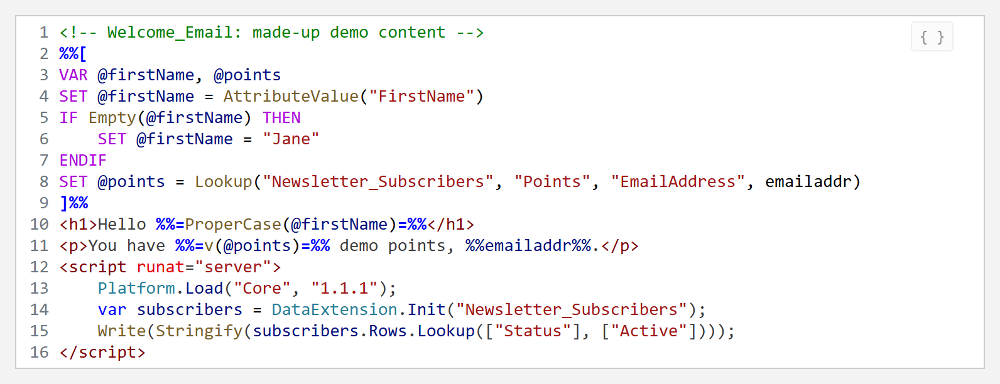

Marketing Cloud colours HTML but shows AMPscript as plain black text. The extension colours it, which makes code much easier to read.

- **AMPscript** gets colours for keywords, functions, variables, texts, numbers and comments. This covers `%%[ ... ]%%` blocks, `%%= ... =%%` expressions and AMPscript inside a script tag.
- **Personalisation strings** such as `%%emailaddr%%` are coloured too.
- **Server-side JavaScript (SSJS)**: Marketing Cloud's own names, such as `Platform`, `DataExtension` and `Write()`, get a colour of their own, so they stand out from ordinary JavaScript.
- **CloudPages code resources**: Marketing Cloud shows them without colours. JavaScript, CSS, JSON, XML and RSS resources are now coloured as what they are, and AMPscript or SSJS inside them is coloured as well.
- **Only the colours change.** Your content stays exactly as you wrote it.
- **One limit:** a script tag is only recognised if its opening tag fits on one line.

### Light and dark theme

[](#marketing-cloud-engagement)

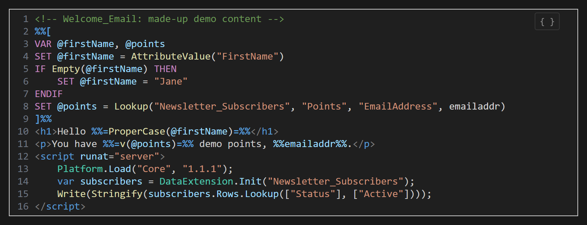

- The editor follows your computer: dark if your computer is in dark mode, light otherwise. It switches along when your computer does.
- You can fix it to **Light Modern** or **Dark Modern** in the options. These are the colour schemes of the code editor Visual Studio Code.
- The theme covers the whole editor: background, line numbers, selection and all code.
- It replaces the themes from Marketing Cloud's own menu.
- The SQL query activity follows the theme too and keeps Marketing Cloud's colours for SQL.

### Suggestions while you type

[](#marketing-cloud-engagement) [](#marketing-cloud-next)

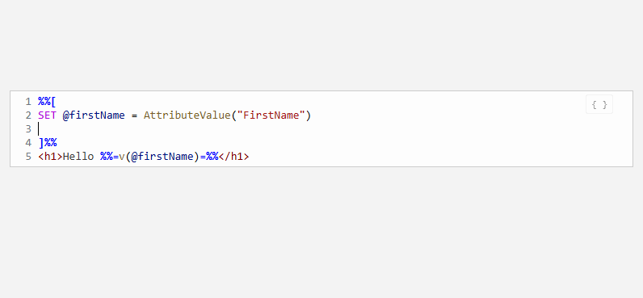

While you type code, a small list offers what fits. Pick an entry and it is written for you.

- **Open the list at any time** with **Ctrl+Space**.
- **AMPscript**: functions, keywords, personalisation strings and the variables you already use in the same content.
- **SSJS**: Marketing Cloud's functions and objects, the JavaScript functions that really work in Marketing Cloud, and the functions you wrote yourself in the same content.
- **Find a function by any part of its name**: `Loo` finds `Platform.Function.Lookup`, and so does `Platform.Function.Loo`.
- **One step at a time**: typing `plat` offers `Platform`; after `Platform.` you see what is inside it, and so on. Upper and lower case do not matter.
- **After a dot**, you get what belongs to the thing in front of it. For example, after a variable that holds a data extension you get `Rows`, and after that `Add`, `Retrieve` and so on.
- **JavaScript for the browser** (any other script tag, and JavaScript code resources of CloudPages): the names used in your browser scripts and the usual JavaScript words. Marketing Cloud's server-side names are kept out, because they do not work there.
- **Picking a function** writes its name and the opening bracket. Nothing is written unless you pick it.
- **In AMPscript**, the list stays away inside texts and comments and in plain HTML.
- **Keys in the list**: the arrow keys move, **Enter** or **Tab** picks, **Esc** closes. In the script activity, **Page Up**, **Page Down**, **Home** and **End** work as well.
- **Not covered yet**: in browser scripts, what belongs to a value, such as the functions of `document`.
- **In Marketing Cloud Next**: every AMPscript function, also the ones the editor leaves out. While you type a function name inside `%%[ ]%%` or `%%= =%%`, and on **Ctrl+Space** there, the extension suggests all 64 AMPscript functions Marketing Cloud Next has.
    - The editor's own list only opens at the moment you type `%%=` or `%%[`. While it is open, ours stays away.
    - **Handlebars helpers:** inside `{{ }}`, while you type a name and on **Ctrl+Space**, the extension suggests the helpers Marketing Cloud Next has. Picking one writes its name and a blank.
        - After `{{#` only helpers that open a block are offered, such as `if` and `each`. Picked without the `#`, such a helper brings it along.
        - Nothing is offered where no helper goes: after `{{/`, `{{>` and `{{!`, and where a field stands, as after the helper in `{{uppercase …}}`.
        - While the editor's own list is open, ours stays away here too.
    - The editor's own list offers 37 AMPscript functions. These 27 are missing from it; with the extension you get them suggested, explained and with help for their inputs: `Base64Decode`, `Base64Encode`, `BeginImpressionRegion`, `BuildRowSetFromString`, `BuildRowSetFromXML`, `Char`, `ClaimRow`, `ClaimRowValue`, `ContentBlockByID`, `ContentBlockByKey`, `ContentBlockByName`, `DatePart`, `Domain`, `EndImpressionRegion`, `GUID`, `IsEmailAddress`, `IsNullDefault`, `MD5`, `RaiseError`, `RegExMatch`, `ReplaceList`, `RetrieveSalesforceObjects`, `SHA1`, `SHA256`, `SHA512`, `StringToHex`, `URLEncode`.
    - Counted in the editor of an email content block in November 2026; Salesforce may add to its lists at any time.

### Explanations when you point at code

[](#marketing-cloud-engagement) [](#marketing-cloud-next)

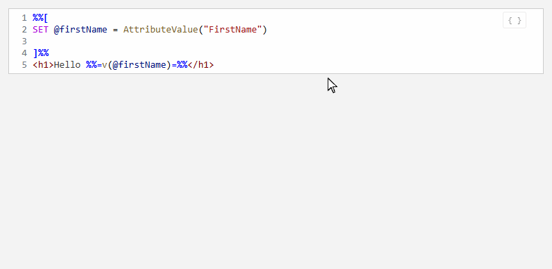

- **Rest the mouse** on an AMPscript function, keyword or variable, or on one of Marketing Cloud's SSJS functions. A box explains what it does, what you have to give it, what you get back, shows an example and links to the full documentation.
- **One link, to the page that fits:** for AMPscript the box links the function's page on sfmc.guide, for Engagement or for Next, matching the Marketing Cloud you are in. Where sfmc.guide has no Engagement page yet, it links ampscript.guide. For SSJS the box links ssjs.guide.
- **Your own SSJS code is explained too**: point at one of your variables or functions and the box says what it is.
- **You can move the mouse into the box** to scroll it or click a link.
- Nothing is shown inside browser scripts.
- **In Marketing Cloud Next**: every AMPscript function Marketing Cloud Next has is explained.
    - The editor explains 41 functions itself, in one sentence each. While the mouse is on AMPscript, the extension hides that box and shows its own, so you never get two explanations at once. On a Handlebars helper it is the same: our box explains the helper, with its inputs and an example, and says where Marketing Cloud Next behaves differently from Salesforce's documentation. On a field inside `{{ }}`, which only the editor knows, the editor's box stays.
    - 23 functions that came with API version 68 get no explanation from the editor at all. For those, ours is the only one: `Base64Decode`, `Base64Encode`, `BeginImpressionRegion`, `BuildRowSetFromString`, `BuildRowSetFromXML`, `Char`, `ClaimRow`, `ClaimRowValue`, `DatePart`, `Domain`, `EndImpressionRegion`, `GUID`, `IsEmailAddress`, `IsNullDefault`, `LookupOrderedRows`, `LookupRows`, `MD5`, `RegExMatch`, `SHA1`, `SHA256`, `SHA512`, `StringToHex`, `URLEncode`.

### Which box is the extension's

[](#marketing-cloud-engagement) [](#marketing-cloud-next)

- Every box of the extension, such as an explanation or the help for a function's inputs, has its small icon in the top right corner.
- Marketing Cloud's own boxes have none, so you always know who is speaking.
- In Marketing Cloud Next, the extension's list of suggestions has the icon in its corner too.
- Rest the mouse on the icon, here and wherever else the extension shows it in Marketing Cloud, to read in one sentence what the extension added or changed at that place.

### Help with a function's inputs

[](#marketing-cloud-engagement) [](#marketing-cloud-next)

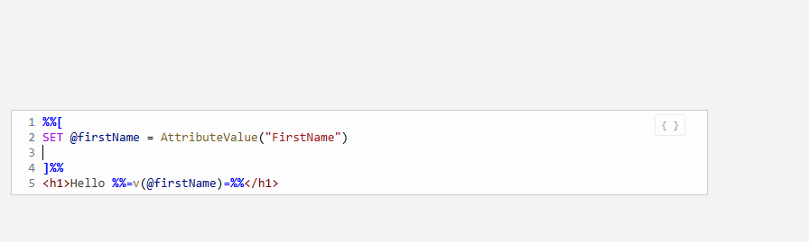

- While your cursor is inside the brackets of a function, a box above the line lists the inputs the function expects and marks the one you are typing.
- It also works when you click into a call that is already written.
- It works for AMPscript functions, Marketing Cloud's SSJS functions and your own SSJS functions.
- **Esc** closes it.
- **In Marketing Cloud Next**: for every AMPscript function.

### Mistakes are underlined

[](#marketing-cloud-engagement) [](#marketing-cloud-next)

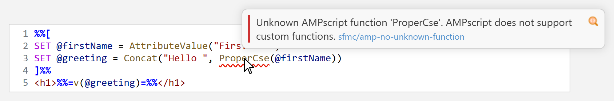

The extension checks your AMPscript and SSJS while you type.

- **Red** means it will not work. **Yellow** is a warning.
- **Rest the mouse on an underline** to read what is wrong, with a link to more information.
- **AMPscript**: unknown functions, too few or too many inputs, blocks and `IF` statements that are never closed, and more.
- **SSJS**: modern JavaScript that Marketing Cloud does not understand (`let`, arrow functions, …), functions Marketing Cloud does not have, a missing `Platform.Load`, and more.
- **SSJS, deeper checks**: mistakes in how you use Marketing Cloud's objects or your own code, such as a misspelt function name (`de.Rowz`).
- **Script activity**: a mark next to the line number shows where a problem is. Rest the mouse on the mark to read all problems of that line in the same box.
- **Fixed in the script activity:** Marketing Cloud's own check marked the `<script runat="server">` tag as an error although it is correct. That false error is gone. **Validate Syntax** still asks Marketing Cloud as before.
- **SQL query activity**: your query is checked while you type, without a click on **Validate Syntax**.

    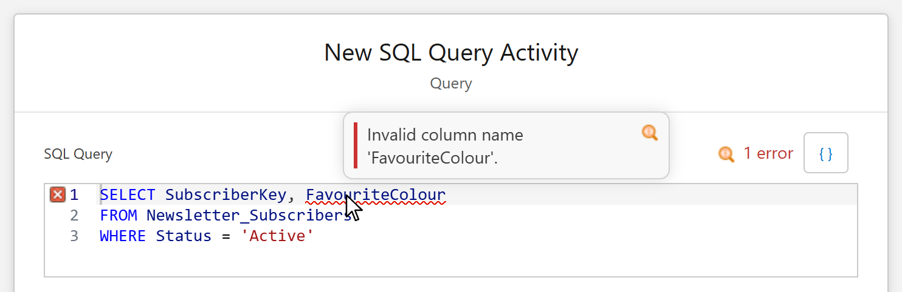

    - **A status tells you the result:** next to the **{ }** button, marked with the extension's icon, you read **Checking…**, **No problems found**, or how many errors and hints there are, such as **2 errors, 1 hint**. It is always about the text that is in the editor right now, and it is empty while the query is empty.
    - **The Validate Syntax button is hidden while there is a query:** the status says what a click on it would say, so the button is not needed. While the query is empty, nothing is checked and the button stays.
    - **When the button comes back:** if Marketing Cloud gives no answer, the status says **Could not check** and **Validate Syntax** is shown again, so you can always check by hand. The extension tries again the next time you type.
    - **What is found:** mistakes in the SQL itself, a data extension or data view that does not exist, and a field that does not exist in it.
    - **Who checks:** Marketing Cloud itself. The extension sends the query to the same check that the **Validate Syntax** button uses, a moment after you stop typing, and nowhere else.
    - **Where you see it:** a mark next to the line number, and an underline on a wrong name wherever it stands in the query.
    - **How you read the message:** rest the mouse on the underline or on the mark. The message opens in the extension's box, right at that place, like the box for a mistake in the script activity.
    - **Hints too:** Marketing Cloud's hints, such as a missing `WHERE`, are shown in yellow at the place they name.
    - **One wrong field at a time:** Marketing Cloud names only one unknown field per check. Fix it and the next one shows up.
    - **When Marketing Cloud does not say where:** the mark is at the start of the query.
- **A `<script>` that will be lost** (Content Builder): Marketing Cloud removes JavaScript for the browser from emails, email templates and content blocks when it saves them, and still says the save worked. The extension underlines the opening `<script>` tag.

    

    - **Red** in an email and an email template, also in a block you edit inside an email.
    - **Yellow** in a content block on its own: it may have been meant for a CloudPage, but the block loses the script when it is saved all the same.
    - **Not marked:** server-side scripts (`<script runat="server">`), AMPscript, and everything in CloudPages, which keeps such scripts.
    - **Good to know:** after the save the editor may still show the tag although the stored content no longer has it. If you meant server-side JavaScript, add `runat="server"` to the tag.
- **A tag typed into the text editor** (Content Builder): the **Content** tab of a free form block and a text block is a text editor. A tag typed there, such as `<script>` or `<div>`, is saved as plain text: readers see it as written, and code in it never runs.

    

    - **Yellow underline** on every piece of text that looks like an HTML tag.
    - **A note above the editor** says what happens and that HTML and code belong in the HTML Editor tab of the block.
    - **Not marked:** formatting made with the editor's buttons, comparisons such as `a < b`, and AMPscript in `%%[ ]%%` and `%%= =%%`.
    - **Only a warning:** saving works as before.
- **Not covered**: what is inside a browser script is not checked, and there is no list of all problems yet.
- **In Marketing Cloud Next**: AMPscript that Marketing Cloud Next does not support is underlined, such as a function that only Engagement has, and so is server-side JavaScript. Point at the underline to read why.
    - **Handlebars too:** a helper that Marketing Cloud Next does not have, and a helper written in the wrong case (`properCase` instead of `propercase`), are underlined. So are a block closed with the wrong name, a block that is never closed, and an expression without its `}}`.

### One-click fixes

[](#marketing-cloud-engagement) [](#marketing-cloud-next)

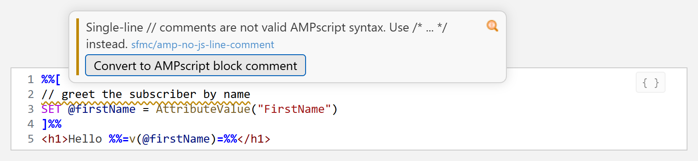

- Where the extension knows a remedy, the box of a problem offers it as a button.
- **Ctrl+.** (**Cmd+.** on a Mac) opens the fixes for the problem at your cursor. **Enter** applies the first one, **Esc** closes the box.
- **Ctrl+Z** undoes a fix in one step.
- **In Marketing Cloud Next**: the same, for the AMPscript mistakes the extension underlines there. A Handlebars helper in the wrong case is corrected with one click, also in the closing tag of its block.

### Jump to where something is defined

[](#marketing-cloud-engagement)

- Hold **Ctrl** (**Cmd** on a Mac) and click a name from your own SSJS code. The cursor jumps to the place where it is defined.
- Works for your functions, variables and the parts of your own objects, within the same content.
- Does not work for Marketing Cloud's own names or for AMPscript.

### Tidy up your code (formatting)

[](#marketing-cloud-engagement) [](#marketing-cloud-next)

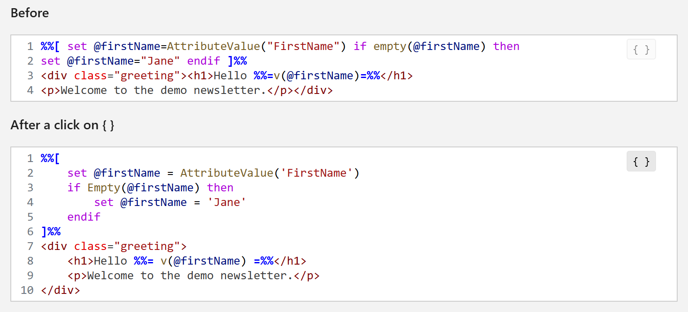

- Click the **{ }** button in the editor's toolbar, or press **Shift+Alt+F**. The whole content is tidied: indentation, line breaks and spacing.
- Covers AMPscript, SSJS, HTML, CSS and browser JavaScript.
- **Ctrl+Z** undoes it in one step.
- **Only the text in the editor changes.** Nothing is saved until you save.
- AMPscript that contains a mistake is left exactly as written; the rest is tidied.
- It always tidies the whole content, not just a selection.
- **Script activity and SQL query activity**: the **{ }** button sits next to **Validate Syntax**; in the SQL query activity, where that button is hidden, it sits next to the [status of the check](#mistakes-are-underlined). A query is tidied as SQL.
- **CloudPages code resources**: JavaScript, CSS and JSON resources are tidied. A resource that mixes its own code with AMPscript or SSJS is left as it is, so nothing gets rearranged by mistake. XML, RSS and text resources have no **{ }** button.
- **Format on save** (an option, off by default): your code is tidied automatically each time you save. In the script activity and the SQL query activity this happens when you click **Next**. It does not apply to CloudPages code resources, because their Save and Publish buttons sit outside the editor.
- **In Marketing Cloud Next**: **Shift+Alt+F** tidies the code; there is no **{ }** button and no format on save. One **Ctrl+Z** takes it back.

### Save with Ctrl+S

[](#marketing-cloud-engagement)

- **Ctrl+S** (**Cmd+S** on a Mac) in the code view of Content Builder saves your content, just like Marketing Cloud's **Save** button.
- Without the extension, that key opens the browser's "save this page" window instead.
- **Saves what you see:** Content Builder takes over a change from the editor only about half a second after it was made. The save waits until Content Builder has the code the editor shows, so a save right after typing, or right after tidying with format on save, keeps your last change. If Content Builder gives no sign for three seconds, the save goes through anyway.
- Content Builder only: the activities of Automation Studio save at the end of their wizard.

### The browser's right-click menu in the code editor

[](#marketing-cloud-engagement)

- A right-click in the code editor opens your browser's normal menu (copy, paste, spell check, …) instead of the menu Marketing Cloud draws over your code.
- The gear button below the editor, which opens that same Marketing Cloud menu, is hidden.
- You can get Marketing Cloud's menu and the gear button back in the options.

### Readable keys

[](#marketing-cloud-engagement)

When you create something and leave its **External Key** empty, Marketing Cloud invents a random one such as `77E29FD6-6E4B-42EB-AA34-E4D6F91DCCCD`. With the extension, the key is filled in from the name while you type it: `Welcome series - step 2` becomes `Welcome_series_-_step_2`.

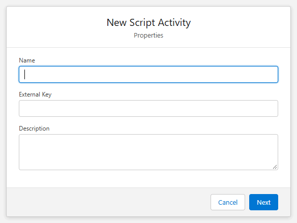

Where it works:

- **Automation Studio**: the dialogs that create an **SQL query**, **script**, **filter**, **import**, **data extract**, **file transfer** or **Contact to Business Unit Mapping** activity.
- **Automation Studio**: a new **automation**. Its key is on the **Summary** tab and in the **Save Automation** dialog, which appears when you save an automation that has no name yet.
- **Contact Builder**: the dialog that creates a **data extension**.
- **Email Studio**: the dialog that creates a **data extension**.
- **Email Studio**: the page that creates a **triggered send** (Interactions → Triggered Emails → Create).
- **Email Studio**: the dialog that saves a new **data filter** (Subscribers → Data Filters → Create, then Save). It is the same dialog for a filter on profile attributes and for one on a data extension. If the dialog answers **Error: Internal server error**, the key is most likely used by another data filter already: change the key and save again.
- **Content Builder**: a new **content block** and a new **email message**. See below.
- **Setup**: the pages that create a **sender profile**, a **send classification**, a **delivery profile**, a **file location**, a **role** or a **user**. A user's key is made from the **username** (the login), not from the person's name, and keeps its dots and its `@`. If a password manager puts a saved login into the External Key field of a new user, the extension replaces it with the key made from the username.
- **Journey Builder**: a new **journey** of any kind (multi-step, single send, transactional), a new **API event**, and the key a **transactional journey** asks for. See below.

In Journey Builder:

- **Journeys have no key field at all.** Journey Builder makes up a random key when you save a new journey, and the key of a journey can never be changed afterwards. With the extension, the journey is saved with a key made from its name instead.
- **You can see and change the key before you save.** The details below the journey's name (Description, Status, Version, …) get a **Key** field. It opens by itself for a new journey, shows the key made from the name, and follows the name while you type. Type your own key there if you want another one.

    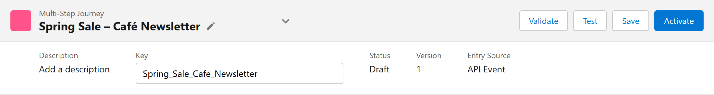

- **You can read the key of a saved journey.** Once the journey is saved, the same place shows its key as text. Click it to mark the whole key, then copy it. Open the details with the small arrow next to the journey's name. This also works with readable keys switched off.
- **API events show their key but do not let you change it.** With the extension, the **Event Definition Key** of a new API event is a field you can type in, with the same look as the **Activity Name** field next to it. It starts with a key made from the event's name.
- **Transactional journeys ask for an Event Definition Key.** The extension fills it in from the journey's name. You can change it before you save.
- **A key that is already used gets a number.** If another journey or event already has the key, yours gets `_2`, `_3` and so on. This matters: Marketing Cloud does not refuse a second journey with the same key, it quietly turns it into a new version of the first one.
- **Journeys and events that already exist are never touched**, and neither is a new version of a journey.
- **Other kinds of entry events** (data extension, CloudPages, Salesforce data, …) keep the key Journey Builder gives them.

In Content Builder:

- **Content blocks ask for a name when you save them the first time.** That dialog has a **Customer Key** field, which the extension fills from the name while you type.
- **Email messages have no key field.** Marketing Cloud gives a new email a random key. With the extension, the email is saved with a key made from its name instead. This covers all three kinds: HTML, template-based and text only.
- **A key that is already used gets a number.** Marketing Cloud refuses a second piece of content with the same key. So if the key is taken, yours gets `_2`, `_3` and so on, for emails and for blocks whose key came from the name.
- **A key you typed yourself for a block is sent as you typed it.** If it is taken, Marketing Cloud tells you.
- **Keys of content are at most 36 characters long**, so a long name is cut.
- **Emails and blocks that already exist are never touched.**
- **Everything else you can create there** (templates, images, uploads, mobile and chat messages) keeps the key Marketing Cloud gives it.

How the key is built:

- Spaces become underscores.
- Accents are removed: `ö` becomes `o`.
- Only the letters A to Z, digits, underscores and hyphens are kept. Everything else, including dots, is left out. The one exception is the key of a new user, which keeps dots and `@`.
- The key is shortened to the length the field allows.
- A name with none of these characters, for example one in Japanese, gives no key. Marketing Cloud then uses a random one, as before.

Good to know:

- **Your own key wins.** As soon as you type a key yourself, the extension leaves it alone. Empty the field and it follows the name again.
- **Only for new things.** If a dialog opens with a key, because you are editing something that exists, that key is never changed. A new automation's key follows its name only until the automation is saved.
- **Nothing is saved for you.** The extension only fills the field, or in Journey Builder the key that is sent when you save. In the dialogs, Marketing Cloud tells you when you finish if the key is already in use.
- **Longer keys for data extensions:** Contact Builder's dialog stops the key at 36 characters, although Marketing Cloud accepts 200. The extension lets you use all 200.
- You can switch readable keys off in the options.

### Journey Builder: a real name before saving

[](#marketing-cloud-engagement)

Every new journey starts with a name like "New Journey - 18 November 2026 at 11.03". It is easy to save it that way by accident, and the name is also handed on to the journey's API event.

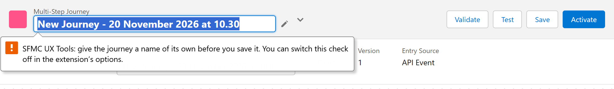

- **Save is held back** while the journey still has that made-up name. The name field opens with the old name selected, so you can type the new one right away.
- This applies to **Save**, **Validate**, **Test** and **Activate**.
- As soon as the journey has a name of its own, saving works as usual.
- Journeys that already exist are not affected.
- You can switch this check off in the options.

### Fixed: pasting a name or key with the mouse

[](#marketing-cloud-engagement)

In Contact Builder's dialog for a new data extension, Marketing Cloud ignores text that you paste with the mouse (right-click → **Paste**) or drag into the field. The field shows your text, but it is not used.

- **Pasted key:** without the extension, your data extension gets a random key instead of the one you pasted. With the extension, your key is used.
- **Pasted name:** the same fix applies to the name field.
- **Always on.** This fix has no switch and also works when readable keys are switched off.
- Pasting with **Ctrl+V** was never affected.

### Fixed: an automation's name is kept when you click Save

[](#marketing-cloud-engagement)

In Automation Studio you name a new automation in the small field at the top left. That field has its own **Done** and **Cancel** buttons.

- **Without the extension:** if you type a name and click anywhere else, for example on **Save**, Marketing Cloud throws the name away. The "Save Automation" window then tells you that the automation has no name.
- **With the extension:** a click anywhere else keeps the name you typed, as if you had clicked **Done** first.
- **Cancel** still drops what you typed.
- **Always on.** This fix has no switch.

### Fixed: no saved logins in a new user

[](#marketing-cloud-engagement)

When you create or edit a user under **Setup → Users**, the page has a username and password fields. A browser's password manager takes that for a login form.

- **Without the extension:** the browser fills one of your saved logins into the **Username**, the **External Key** and the **Temporary Password** of the user you are creating. If you do not notice, the new user is saved with someone else's details.
- **With the extension:** the browser is told that these are not login fields, so it leaves them empty.
- Chrome still shows its list of saved logins when you click into **Temporary Password** or **Confirm Password**; the extension cannot switch that list off. If you pick an entry from it by mistake, the extension takes out again what Chrome fills in. What you type there yourself stays.
- Password managers that are extensions (LastPass, 1Password, Bitwarden, Dashlane) are told to skip these fields too.
- LastPass pastes a saved login into the **Username** anyway when you click into it. The extension takes it out again at once; what you typed or pasted yourself stays.
- If a password manager writes a saved login into the **External Key** anyway, the extension puts back the key made from the username. A key you typed yourself stays.
- You can switch this off in the options, under **Saved logins on Setup's user pages**.

### Select all scopes of an installed package

[](#marketing-cloud-engagement)

When you add or edit an API integration under **Setup → Platform Tools → Apps → Installed Packages**, the dialog lists around a hundred checkboxes.

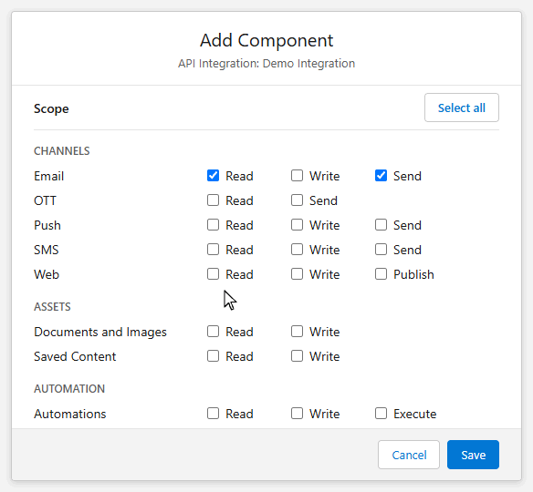

- A **Select all** button in the **Scope** bar ticks every scope, including the ones scrolled out of view.
- Once everything is ticked, the button turns into **Deselect all**.
- Nothing is saved until you press the dialog's own **Save** button.
- Works in every language of Marketing Cloud, when adding a component and when editing one.

### Transactional messages: SMS, push and OTT

[](#marketing-cloud-engagement)

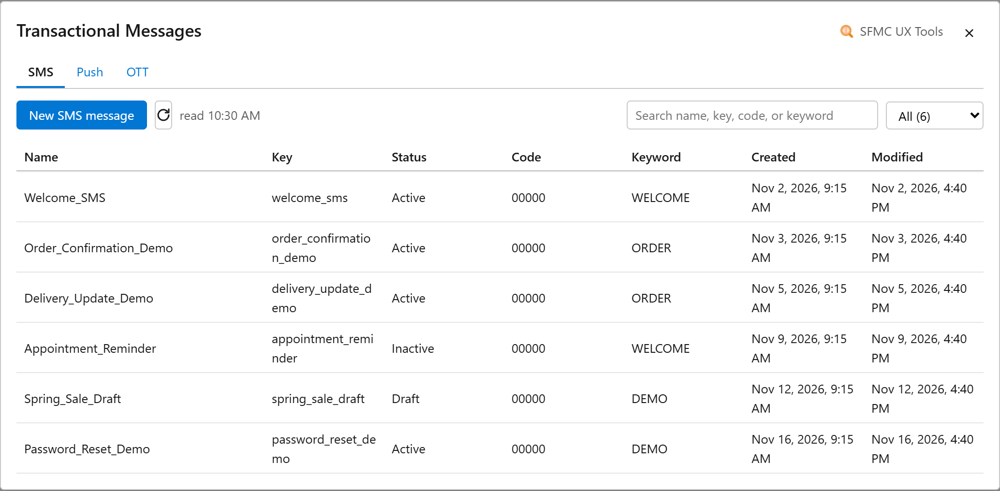

Marketing Cloud can send transactional SMS, push and OTT messages (OTT covers WhatsApp and similar channels). They are set up through the API only: no app of Marketing Cloud shows which ones exist. The extension adds a place to see, create, change and delete them.

The folder names of contents, the texts of a push content, the list for personalization and saving custom keys were seen answering on a real account. They were tried with the same requests the panel sends, not by clicking through the panel itself.

- **Closing the panel:** only the **×** in its corner closes it. **Esc** closes an open list or box inside the panel, but never the panel itself, so that nothing typed is lost by accident.
- **A new entry in the menu:** point at **Mobile Studio** at the top of Marketing Cloud. Below MobileConnect, MobilePush and GroupConnect you find **Transactional Messages**. The small icon behind it is this extension's, to show who added the entry.
- **A list per channel:** the panel that opens has the tabs **SMS**, **Push** and **OTT**. Each lists the messages of the business unit you are in.
    - **Columns:** name, key, status, and the dates a message was created and last changed, in your local date and time. SMS also shows **Code** and **Keyword**, push shows **App** and **Content** by their names.
    - **Search:** type into the search box to filter by name, key and the channel columns.
    - **Show by status:** the list next to the search box shows only the messages of one status.
        - It offers **All** and every status that occurs in the list, each with its number, such as "All (249)", "Active (237)", "Inactive (1)", "Draft (11)".
        - It works together with search, sorting and the pages.
        - Your choice is kept per tab, also when you open a message and come back or reopen the panel.
        - The numbers are counted again when the list is read again. If no message has the chosen status any more, the list shows all.
    - **Sorting:** click a column heading; click again to turn the order round.
    - **Pages:** 50 messages per page, with **Previous** and **Next**.
    - **Only the rows scroll.** The column headings, the bar above the list and the page buttons below it stay in place.
    - **Long lists are read completely.** The panel reads 100 messages per request until Marketing Cloud has no more.
- **The list is kept, not read again and again:** switching tabs, coming back from a message and reopening the panel show the list from memory.
    - It is read again after you created, changed or deleted a message in the panel, when you click the **Refresh** button, and after you reload the page.
    - **Refresh** is the button with the reload sign next to **New … message**. Point at it to read its name.
    - A note beside it says when the list was read, such as "read 14:05".
    - It is also dropped when you change the business unit.
- **Code, keyword, app and content come a moment later:** Marketing Cloud's list does not contain them, so the panel reads each message once in the background, a few at a time, and says how far it is ("details 120 of 312").
    - What was read is kept for as long as the page is open. After a refresh, only messages that are new or were changed are read again.
    - Until all are read, sorting by these columns is switched off, and a search finds them only in the messages already read.
    - If some details cannot be read, the note says how many, such as "2 of 312 details could not be read", and sorting works anyway. Those messages sort as if the column were empty. They are asked for again the next time the list is shown.
    - **Messages Marketing Cloud lists but cannot open are left out.** Marketing Cloud sometimes lists an SMS message whose details it cannot find, for example after the mobile message behind it was deleted. The panel then reads the list once more to make sure, and hides the message.
        - The extension remembers it in its own storage, so the next time the list is shown without asking for it again.
        - If the message is changed later, or a new one gets the same key, it is shown again.
        - A message that cannot be read for any other reason, such as a server error, stays in the list.
    - On the first opening of a list with several hundred messages, that many requests go out once.
- **The details of one message:** click a row to see everything Marketing Cloud stores for it, with plain labels such as **Key**, **Message** or **Code**. Point at a label to see the name of the field in the API. **← All … messages** takes you back.
    - **Names first:** for a push message, the name of its app and of its content comes first, and the ID or key after it in small grey letters. The same goes for the content of an OTT message. If the name is not known, only the ID or key is shown.
    - **The text of an SMS is shown in the code editor**, as in the form, but only to read:
        - It has the same colours, and explains a function when you point at it.
        - You can mark and copy the text. You cannot change it there; use **Edit** for that.
        - It is as tall as the text, up to a limit; a longer text scrolls.
        - If the editor cannot be loaded, the text is shown as plain text, as before.
        - It has no **{ }** button and is never tidied: nothing changes a message you only look at.

    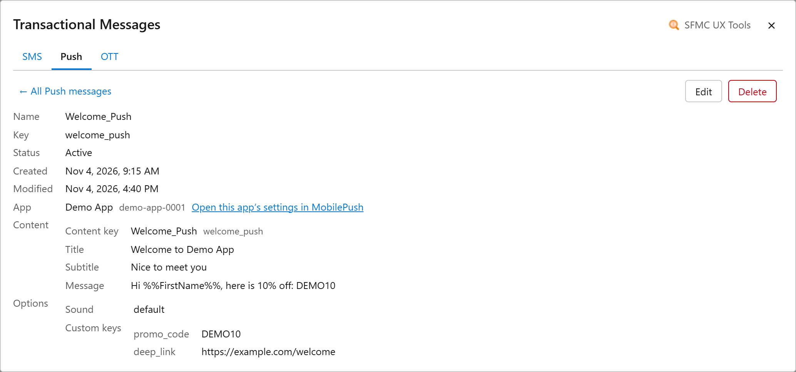

    - **What a push message says:** under the content key, the details show the **Title**, **Subtitle** and **Message** of the chosen content, read from Content Builder. They are shown as they are written there, AMPscript included, and cannot be changed here. A text that is empty is left out; if the content cannot be read, the lines are simply missing.
    - **Custom keys of a push message** are listed by their name, each with its value.
    - **A warning for custom keys the app no longer has:** if a push message holds custom keys that its app does not define, a warning box at the top names them and says that saving the message here removes them. The keys are marked in the list below it.
        - The **Push** list shows a warning sign in the **App** column of such a message. Point at it to read the keys.
        - Nothing is marked when the list of apps cannot be read or does not have the app.
    - **Open this app's settings in MobilePush:** a link next to the app of a push message opens the screen where the custom keys of that app are set up, in a new tab.
    - **Open in Content Builder:** a link next to the content of a push message opens that push message in Content Builder, in a new tab. The details and the form stay open.
        - The form for changing a push message has the same link, below the **Content** field. Choose another content there and the link follows.
        - The link is one of the extension's [links to an asset](#links-to-a-content-builder-asset), so it also works for a colleague who has the extension.
        - There is no link when the content is not in the list of Content Builder, or when the panel cannot find out which business unit you are in.
        - SMS and OTT messages have no such link.
    - **Open this code in MobileConnect:** a link next to the code of an SMS message opens that code in a new tab. It is shown once the list of codes is read and has the code.
- **Create a message:** every list has a **New … message** button. It opens a form with the fields of that channel:
    - **SMS:** name, key, description, status, the text of the message, the code and keyword it is sent with, the country code of a short code, and whether the recipient is added or updated as a subscriber.
    - **Push:** name, key, description, status, the app, the custom keys of that app, the content (the customer key of the push message in Content Builder), sound and badge.
    - **OTT:** name, key, description, status, the sender (WhatsApp and its phone number) and the content.
    - **No saved logins in these forms:** the fields have names that password managers do not take for a login or a person's name, so that they leave the forms alone.
- **The text of an SMS is written in a code editor**, like the code view of Content Builder:

    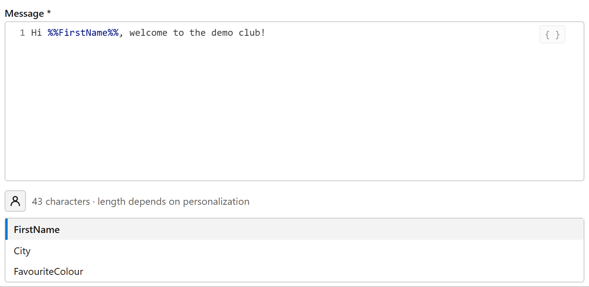

    - **Colours** for AMPscript and personalisation strings, in the light or dark theme chosen in the options.
    - **Suggestions** while you type and on **Ctrl+Space**, **explanations** when you point at a function, **help with a function's inputs**, and **underlined mistakes**.
    - **Keys:** **Tab** moves on to the next field. **Esc** closes an open list of suggestions and leaves the form open. **Ctrl+S** does nothing here; the message is saved with the button of the form.
    - **Tidy the message with one click:** the **{ }** button in the corner of the editor, or **Shift+Alt+F**, tidies the AMPscript in the message: indentation, line breaks and spacing. One **Ctrl+Z** takes it back.
        - Plain text lines stay exactly as you typed them.
        - If the message cannot be tidied, a small box in the editor says why, and the message stays as it is.
    - **Format on save** (the option of that name, off by default): a click on **Save** or **Create** tidies the message first and then saves it.
        - The save is never lost: if the message cannot be tidied, it is saved as it is.
        - If you leave the form while it is still tidying, nothing is saved.
    - If the editor cannot be loaded, the plain text field stays and works as before.
    - The forms for push and OTT have no such field and are unchanged.
- **Helpers below the text of an SMS:**
    - **Insert personalization:** the button with the person sign opens a list of the attributes your business unit added to **MobileConnect Demographics**. Choose one and `%%Name%%` is put in at the cursor.
        - **Keys:** the arrow keys move through the list, **Enter** or **Space** takes the marked attribute, **Esc** closes the list and leaves the form open.
        - If the business unit has no such attributes, or they cannot be read, the button is not shown.
    - **Length:** a line says how many characters the message has, such as "42 characters".
        - Characters from the extension table of the GSM alphabet, such as `€` or `[`, count as two.
        - Characters that are not in the GSM alphabet, such as emoji or typographic quotes, are counted separately: "3 not in the GSM alphabet".
        - If the message contains `%%`, the line adds "length depends on personalization".
        - The panel does not say how many SMS parts a message needs or what it costs.
    - **Show non-GSM characters:** this button marks those characters in the code editor. The marks go away as soon as you change the message; click again to see them again.
        - The button is shown only when the message has such characters, and only with the code editor.
    - Both helpers also work with the plain text field, except for the marks.
    - A message that cannot be changed in the form has no helpers.
- **The key follows the name** while you type, as with [readable keys](#readable-keys) elsewhere, until you type a key yourself. The **Readable keys** option switches this off.
- **SMS code and keyword are two lists:** choose the code first; the keyword list then shows only the keywords of that code. A code reads like `8850 · NL · short code · SHARED`.
    - Both lists are in alphabetical order, the same every time.
    - If Marketing Cloud's lists cannot be read, both are plain text fields.
    - When you edit a message whose code or keyword is not in the lists, it stays chosen and is marked as not found.
    - The lists show what Marketing Cloud returns in its first answer, which is up to 50 codes and 50 keywords.
    - **Add a keyword on the way:** below the keyword list, **Open this code in MobileConnect** opens the chosen code in a new tab. Add a keyword there, then click **Reload keywords** (the button with the reload sign).
        - Reloading reads the codes and keywords again and keeps what you chose. It sends nothing and does not count as a change.
        - If they cannot be read, the lists stay as they were and a line says so.
- **App and content of a push message are chosen from a list** that opens below the field:
    - **The field shows the name**, and a small line below it shows the ID or key. The ID or key is what is sent, as before.
    - **It opens on every click** into the field, also when the field already holds something, and shows all entries.
    - **Every entry is shown in full length:** its name and, beside it, its ID or key. A long one continues on the next line.
    - **Type to narrow it down:** the list keeps the entries whose name or ID contains what you typed.
    - **Keys:** the arrow keys move through the list, **Enter** takes the marked entry, **Esc** closes the list and leaves the form open.
    - **What you type counts like this:**
        - An ID or key that is in the list stands for that entry. When you leave the field, it shows the name.
        - A full name that exactly one entry has stands for that entry, in any upper or lower case.
        - Anything else is sent exactly as you typed it, also a name that two entries share. The line below then says "not in the list – sent as typed".
    - **The field still takes any ID or key you type**, also one that is not in the list.
    - **A message whose ID or key is not in the list keeps it:** the field shows the ID or key itself, and nothing is sent unless you change it.
    - **App:** the list has the apps of the business unit, sorted by name.

        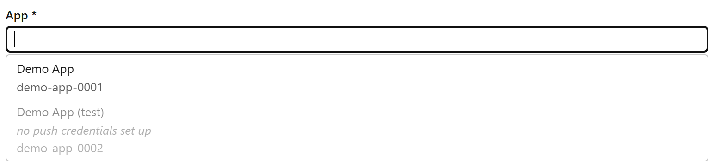

        - **An app without push credentials is greyed out** and says "no push credentials set up". It cannot be chosen, with the mouse or with the keys. These are the apps that MobilePush greys out too: apps with neither Android credentials nor a working iOS key or certificate.
        - **The app a message already has stays.** When you edit a message whose app has no credentials, that app is still chosen, can be kept and can be chosen again.
        - **A typed or pasted ID of such an app is refused:** a line under the field says why, and the form is not sent until you choose another app.
        - If the panel cannot find out which apps have credentials, no app is greyed out or refused.
    - **Content:** the list has the push messages of Content Builder, sorted by name. Choosing one fills in its customer key.

        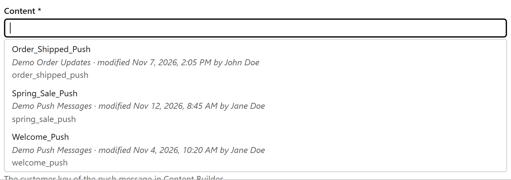

        - Every entry also names its **folder**, **when it was last changed** (in your local date and time) and **by whom**.
        - Typing the name of a folder keeps the messages in that folder.
        - If the folders cannot be read, the entries are shown without them.
        - Messages written for SMS or for in-app are left out: on an account with push messages, every transactional one held a message written for push.
    - If Marketing Cloud's list cannot be read, the field is a plain text field that shows and takes the ID or key.
- **The content of an OTT message is chosen from a list too**, which works like the one of push: name in the field, customer key below it, folder, date and author in each entry, and any typed key is still taken.
    - **Which messages it offers:** the mobile messages of Content Builder that are written for something other than push, SMS or in-app. Each entry says what it is written for.
    - **Why not "WhatsApp messages":** we do not know how Content Builder marks a WhatsApp message. On a real account we only saw messages for push, SMS and in-app.
    - **Not verified:** that the content of an OTT message is a mobile message of Content Builder at all is an assumption.
    - If there is no such message, the list says so, and you type the customer key.
    - The texts of the content, custom keys and the check for push credentials belong to push only.
    - **Sender ID stays a plain field.** Marketing Cloud's list of WhatsApp senders was empty on our account, so we do not know what an entry looks like and built nothing on a guess.
- **Custom keys of a push message:** below the **App** field, the form has one text field for every custom key of the app you chose.
    - Marketing Cloud only accepts custom keys that the chosen app defines.
    - Choose another app and the fields change to the keys of that app. An app without custom keys has none.
    - A key you leave empty is not sent.
    - You never type the name of a key, only its value.
    - When you edit a message, the keys it already has are shown at once.
    - **Keys the app no longer has:** a message can still hold a key that was removed from its app later. Marketing Cloud refuses to save such a message.
        - These keys are not fields. A red box lists them with their values and says they will be removed when you save the message.
        - Saving removes them, also when you changed nothing else.
        - The box has a link **Open this app's settings in MobilePush**. It opens in a new tab, so the form stays open. Add the key to the app there if you want to keep it.
        - Right before saving, the panel reads the list of apps again. If the keys of the app changed meanwhile, nothing is saved and the form shows the new state: check it and save again. If the list cannot be read, nothing is saved either.
        - Choose another app and the same box lists the keys that app does not have. Choose an app that has them and they are back as they were.
        - If the list of apps cannot be read, or the app is not in it, nothing is removed: all keys are sent back as they are stored.
    - Empty a key that had a value and it is taken out of the message.
    - Changing one custom key sends the whole list of custom keys, together with the other options of the message.
- **What Marketing Cloud refuses is shown:** if a message cannot be created, the form says why in Marketing Cloud's words and keeps what you typed.
- **A new message starts as Active** unless you choose another status in the form. An active message can be sent at once by anything that knows its key.
    - **Push has three statuses:** Active, Inactive and Draft. Marketing Cloud stores a new push message as Draft unless it is Active, also when you choose Inactive.
- **Links in an SMS:** two optional boxes switch on Marketing Cloud's link shortening and its tracking of the shortened links per subscriber.

    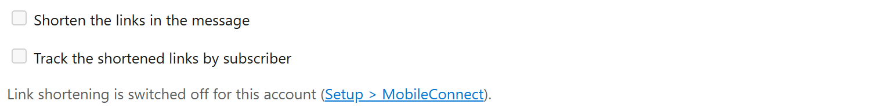

    - **Switched off for the account:** if your account has "Salesforce Link Shortening and Tracking" switched off in MobileConnect's setup, the two boxes cannot be ticked, and a line below them says so.
    - **Setup > MobileConnect** in that line is a link. It opens MobileConnect's administration in a new tab, so the form stays open.
    - A box that is already ticked on a message stays usable, so that you can untick it.
    - A box that cannot be ticked changes nothing in what is sent.
- **Send blockout window:** if your account has a send blockout window in MobileConnect's setup, the SMS form says above the message that messages may be held back during it, with the same link to MobileConnect's administration. There is nothing to fill in.
- **Where this comes from:** the panel reads the MobileConnect settings of the account once, when an SMS form opens, and again after **Refresh**. If they cannot be read, the form is as it would be without them.
- **Change a message:** the details have an **Edit** button. It opens the same form, filled in. The key cannot be changed.
    - Only what you changed is sent. If you change nothing, nothing is sent.
    - Right before saving, the panel reads the message again. If someone changed it meanwhile, or you changed the business unit in another browser tab, nothing is saved and the form says so.
    - After saving, the panel reads the message once more and compares it with what you sent. If Marketing Cloud answered "saved" but holds something else, the panel names the fields that differ.
- **Delete a message:** the details have a **Delete** button. The panel then asks once more, with the name, key and status of the message, and only **Delete it** deletes. Marketing Cloud cannot bring a deleted message back, and whatever still sends with its key will fail.
- **A safeguard against the wrong business unit:** right before deleting, the panel reads the message again. If it is no longer the one on screen, for example because you changed the business unit in another browser tab, nothing is deleted.
- **Creating, changing and deleting were tried on real messages:** on a business unit with SMS and push, a test message of each kind was created, changed and deleted through the panel, and nothing else on that business unit changed. OTT could not be tried, see the last point.
- **What Marketing Cloud does with a deleted message:** it keeps it, marked as deleted, and replaces its key and name with a random ID, so the key is free again. The panel leaves deleted messages out.
- **Always marked as ours:** the panel shows the icon and **SFMC UX Tools** at its top, so nobody takes it for a part of Marketing Cloud.
- **OTT is untested:** it was built from Salesforce's documentation, because we have no account with WhatsApp or a similar channel. If you have one, please tell us whether it works, in the [issues on GitHub](https://github.com/JoernBerkefeld/chrome-sfmc-ux-tools/issues). The tab says so too.

### Delete in Mobile Studio

[](#marketing-cloud-engagement)

MobileConnect has no way to delete a message once it exists, and MobilePush only has one on the page of a single message. Marketing Cloud's API can delete them. The extension adds the buttons.

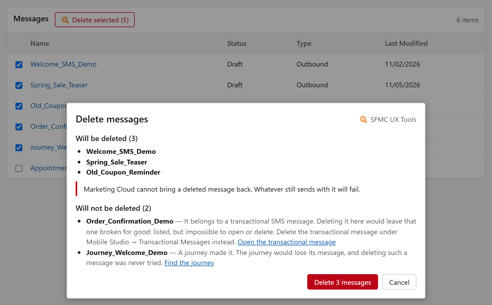

**This deletes data in your account.** Everywhere else in these two apps the extension changes nothing by itself; here it deletes messages when you click and confirm. A deleted message cannot be brought back.

- **Where the buttons are:**
    - **MobileConnect, page of a message:** a **Delete** button in the header, next to the name.
    - **MobileConnect and MobilePush, list of messages:** a checkbox in front of the name of every row, and a button **Delete selected (n)** above the list. The button is grey while nothing is ticked.
    - All of them carry the extension's small icon, to show who added them.
- **Ticking rows:**
    - A click on the checkbox ticks the row and does not open the message.
    - A click right next to the checkbox does nothing. A click on the name opens the message, as before.
    - What is ticked is kept when you search, sort or page the list, as long as the message is still shown. A message that is no longer in the list is no longer ticked.
- **Nothing happens before you confirm:**
    - A dialog reads every chosen message again from Marketing Cloud. It does not rely on what the list shows.
    - It then names the messages that **will be deleted** and, separately, those that **will not be deleted**, each with the reason.
    - Only the click on **Delete n messages** deletes. **Cancel** sends nothing.
- **What is deleted:** every chosen message that is not refused below: SMS messages whatever their status, and push messages that are drafts or inactive. This was tried on a real account with a draft SMS message and with an active, API-triggered SMS message made in MobileConnect, and with a push message.
- **What is refused, and why:**
    - **An SMS message that belongs to a transactional SMS message.** Deleting it leaves the transactional message broken for good: it stays listed and keeps its key, but can neither be opened nor deleted (seen on a real account). Delete the transactional message in the panel [Transactional Messages](#transactional-messages-sms-push-and-ott) instead.
        - **A link takes you there:** the line ends with **Open the transactional message**, which closes the dialog and opens the panel on that message.
    - To find out, the extension reads every transactional SMS message of the business unit, once per dialog. This can take a moment on an account with many of them. If any of them cannot be read, the SMS message is refused, because the danger cannot be ruled out. The one exception: a transactional message that Marketing Cloud says no longer exists is passed over, because it has no SMS message left.
    - Deleted transactional messages stay readable, so they do not get in the way of this check (measured on a real account).
    - **A push message that is triggered by the API and has the same name as a transactional push message.** Nothing else links the two, so the name decides. Delete the transactional message in the panel instead. If the transactional push messages cannot be read, the message is refused.
        - **A link takes you there:** the line of such a message ends with **Open the transactional message**. The click closes the dialog and opens the panel on that message. When several transactional messages have the name, each gets a link with its key.
        - **The list follows:** when you delete a transactional message in the panel and close the panel, the list of MobilePush is loaded again; after a transactional SMS message, the list of MobileConnect.
    - **A push message that is active.** Active push messages are not deleted, however they are sent; drafts and inactive ones are. MobilePush's own delete button refuses active messages too. Make it inactive first.
    - **A message that a journey made.** The journey would lose its message, and deleting such a message was never tried.
        - **A link looks for the journey:** in MobilePush and in MobileConnect, the line of such a message ends with **Find the journey**. Only the click starts the search: the extension reads all journeys of the business unit, in all their versions, which can take half a minute on a large account. The dialog says how far it is.
        - **Found:** the line gets a link per journey version that uses the message, such as **Open journey "Welcome" (version 2, Published)**, which opens the journey in a new tab. The message stays refused.
        - **No journey uses it any more:** the journey, or that version of it, was deleted and left its message behind. Such a message moves to **Will be deleted**, although it is still active. This was tried on a real account for a push message and for an SMS message: the message was deleted and nothing else changed.
        - **The list can move while it is read:** Marketing Cloud hands out the journeys in no fixed order, so now and then one comes twice and another not at all. The extension then reads the list again, three times at most, until it has every version.
        - **Before the delete,** the journeys are read once more. A message that a journey uses by then is left alone.
        - **Push, only plain notifications:** an inbox or in-app message of a journey stays refused even when no journey is found, because nobody has seen how a journey names those.
        - **When in doubt, nothing changes:** if the journeys cannot be read completely, or the Marketing Cloud page is in another business unit than MobilePush, the message stays refused and the link can be clicked again. The same goes for an account with Single Send journeys that the list of journeys does not show.
    - **A message that cannot be read again, or whose answer lacks what the check needs.** When in doubt, nothing is deleted.
- **Never tried, and deleted without a special check:**
    - SMS messages that are scheduled or bound to a keyword.
    - Push messages with automations. MobilePush's own button refuses those, but the message itself does not show them, so the extension cannot tell.
- **Deleting, one message after the other:**
    - Right before its delete, each message is read once more. If it changed meanwhile, or no longer has the name the dialog showed, it is left alone and the result says so.
    - A delete that fails is shown with what Marketing Cloud answered, and the others still go on.
    - At the end the dialog says how many were deleted and how many failed, such as "3 deleted, 1 failed". When you close it, the list is loaded again; from the page of a message, MobileConnect goes back to its overview.
- **Always on:** there is no option for it.
- **Not yet tried by clicking:** the requests were tried on a real account, the buttons themselves so far only in automated tests.

### Links to a Content Builder asset

[](#marketing-cloud-engagement)

The address of Content Builder is always the same, whatever you open in it. So you cannot send a coworker a link to an email or a content block. The extension puts the open asset into the address.

- **What you see:**
    - Open an asset in Content Builder. The address in the browser now ends with the number of your business unit and the number of the asset, such as `#app/Content%20Builder/ux-tools/500001234/asset/12345`.
    - Go back to the list, and the numbers are gone again.
    - The page is not loaded again for this. Only the address changes.
- **The browser's Back and Forward buttons:**
    - They step through what you opened in Content Builder: from an asset back to the list, and forward to the asset again.
    - Before, Back left Content Builder at once and went to the page you were on before it.
    - Back from an asset to the list closes the asset, as its own close button does.
    - Back or Forward to an asset opens it by searching for it, as a link does. Content Builder is not loaded again for this.
    - You can go back and forward as often as you like.
    - Only what you open yourself, with a click or a key, gets a step. What Content Builder shows first, and an asset opened by a link, do not add one.
    - Email Studio is not part of this yet.
- **Sending a link:**
    - Copy the address from the browser and send it.
    - Your coworker needs this extension too.
    - With the extension, the link opens Content Builder, searches for the asset and opens it.
    - This usually takes a few seconds. Right after the page was loaded, Content Builder's first search can take about half a minute.
    - The extension waits up to one minute for the asset to show up in the search. After that it gives up and shows a note.
    - The search is only a helper. Once the asset is open, the search box is emptied again, so the list behind the asset shows everything as before.
- **When your coworker is in another business unit:**

    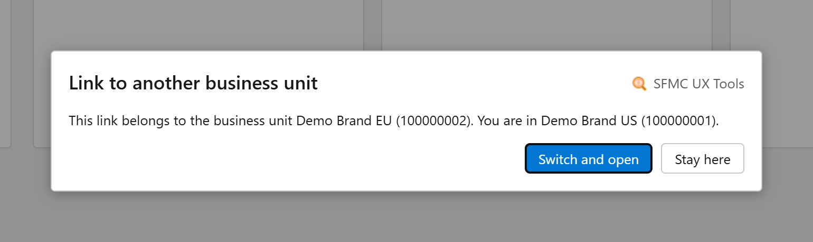

    - The asset is not searched for. A dialog of the extension says which business unit the link belongs to, by name, and which one your coworker is in.
    - The dialog comes early, while Marketing Cloud is still loading behind it.
    - The page behind the dialog is greyed out and cannot be used until one of the buttons is clicked. The Escape key and a click next to the dialog do not close it.
    - **Switch and open** changes to that business unit and opens the asset there.
    - For the switch, the browser goes to Content Builder's plain address in that business unit. The link itself waits in this browser tab meanwhile, and the page that opens after the switch picks it up, once.
    - **Stay here** closes the dialog and leaves everything as it is. The link is then not asked about again.
    - Nothing switches without that click.
- **When the link is from another Marketing Cloud account:**
    - The dialog says that the business unit of the link does not exist in the account your coworker is logged in to, or that they have no access to it.
    - If this browser was in that business unit's account before, the dialog also says its name and the name of its account, such as "Example Shop Germany in Example Shop". This helps people who work in several accounts.
    - There is only **Close**. Log in to the right account and open the link again.
    - This dialog also blocks the page until **Close** is clicked.
- **The list of business units the browser has seen:**
    - To give that hint, the extension keeps the numbers and names of the business units of every account you open, grouped by account.
    - The list stays in this browser, on this computer. It is sent nowhere.
    - To delete it, open the options and click **Forget the business units this browser has seen**.
- **Without the extension:** the link opens Content Builder as usual, on its list. Nothing breaks and no error is shown.
- **When the asset cannot be opened:** a small note of the extension in the corner of Content Builder says so, with the asset's number. Close it with the **×**. Nothing else is clicked or tried again.
- **Limits:**
    - It works for assets in the business unit's own content. An asset that the search does not list, such as shared content of another business unit or a web page made in CloudPages, gives the note.
    - The search shows 30 assets at most. If very many assets have a name like the one of the link, the asset may not be among them, and you get the note.
    - If the link cannot be followed, the search box keeps the name that was searched for, so you can see what was looked for.
    - The link shows the asset as a click in the list does. It does not jump into the editor.
    - Content Builder inside Email Studio's **Content** tab gets no link.
- **Nothing is changed in Marketing Cloud:**
    - To follow a link, the extension reads the asset's name once, searches for it and clicks its row.
    - For the browser's Back and Forward buttons, it clicks the close button of the open asset, or searches for the asset and clicks its row.
    - To know the business unit, it reads which one you are in, and the list of business units of your account. When a link is opened, it also looks at the business unit shown at the top of the Marketing Cloud page, and takes whichever is known first.
    - If the business unit is not known after about 10 seconds, the link is not followed and the dialog says so.
    - It saves and deletes nothing in Marketing Cloud. Switching the business unit is what Marketing Cloud's own menu does too.
- **Always on:** there is no option for it, only the button that deletes the list of business units.
- **Tried on a real account:**
    - The address gets the open asset.
    - A link opens the asset, and the search box is emptied afterwards.
    - In another business unit the dialog comes up.
    - **Switch and open** switches and opens the asset.

### Links into Email Studio

[](#marketing-cloud-engagement)

Email Studio's address does name what you look at, but opening that address again only gets you to the section, with an empty page. The extension makes such a link open the view.

- **What gets a link:**
    - An open data extension.
    - A folder of data extensions.
    - An open list.
    - A folder of lists.
    - A folder of groups.
    - A folder of data filters.
    - Nothing else yet. See **What gets no link** below.
- **What you see:**
    - Open one of these. The address in the browser gets one more part, `ux-tools=`, followed by the number of your business unit and the view, such as `ux-tools=500001234.r.Subscribers.CustomObjects.4711`.
    - Go to something else, and that part changes or goes away.
    - The page is not loaded again for this. Only the address changes.
- **Sending a link:**
    - Copy the address from the browser and send it.
    - Your coworker needs this extension too, to land on the exact view.
    - With the extension, the link opens Email Studio and then opens the view.
    - The extension does not go by a clock here. It waits for Email Studio itself to say that it is ready, however long that takes, and then asks for the view once.
    - Email Studio sometimes shows something else instead, such as the first list of the section, or shows the view and takes it away again a moment later. Only then does the extension ask for the view again, at most 6 times in all.
    - As soon as you click or type in Email Studio, the extension stops this. The link never pulls you back from where you went yourself.
    - While the link is being opened, the address keeps the link. After your first click or key press, or after the last try, the address follows what you open again.
- **Without the extension:** the link opens Email Studio at the section, such as **Subscribers**. Nothing breaks and no error is shown.
- **When your coworker is in another business unit, or in another account:**
    - The same dialog as for [links to a Content Builder asset](#links-to-a-content-builder-asset) comes up, with **Switch and open** and **Stay here**, or only **Close**.
    - For the switch, the browser goes to Email Studio's plain address in that business unit. The link itself waits in this browser tab meanwhile, and the page that opens after the switch picks it up, once.
    - Nothing is opened in the wrong business unit.
- **What gets no link** (the address then leads to the section only):
    - One group. Only the folder it is in gets a link.
    - One data filter. Only the folder it is in gets a link.
    - **All Subscribers**.
    - Everything in **Content**, **Interactions**, **Tracking** and **A/B Testing**, such as emails, templates, sends and reports.
    - The older pages of Email Studio, such as everything under **Admin**. Opening such a page from a link could do more than show it, so this is left out until it is known to be safe.
    - What you did inside a view: the page of a list you paged to, a sort order, a step of a wizard, an open pop-up.
- **Nothing is changed in Marketing Cloud:**
    - The extension only watches what Email Studio shows and sets Email Studio's own route. It asks Marketing Cloud for nothing here, apart from which business unit you are in.
    - A link can only name one of a short, fixed list of views, with a number or an id. It can never name a web address, and the extension never loads an address from a link.
- **Always on:** there is no option for it.
- **Tried on a real account:**
    - Every view listed under **What gets a link**: data extensions and their folders, lists, and folders of lists, groups and data filters.
    - For each of them, the address gets the view, and the link opens it from a freshly loaded page.
    - In another business unit the dialog comes up, and **Switch and open** switches and opens the data extension.
    - What is listed under **What gets no link** was not made to work and gets no link.

### Links into Contact Builder

[](#marketing-cloud-engagement)

In Contact Builder, the address in the browser stays the same whatever you open. So you cannot copy it to show a coworker a data extension. The extension makes the address follow what you open.

- **What you see:**
    - Open Contact Builder and go somewhere in it, for example to **Data Extensions** and then into one data extension.
    - The address in the browser changes with every step. For an open data extension it ends with something like `#app/Contact%20Builder/contactsmeta/admin.html?ux-tools=500001234%23admin/data-extension/<id of the data extension>/properties/`.
    - The number after `ux-tools=` is the number of your business unit (its MID).
    - Go back to the start of Contact Builder, and the address is Contact Builder's plain address again.
    - The page is not loaded again for this. Only the address changes.
- **The browser's Back and Forward buttons:**
    - They step through the places you opened in Contact Builder, one by one, back and forward as often as you like.
    - Before, Back left Contact Builder at once and went to the page you were on before it.
    - Only a place you open yourself, with a click or a key, gets a step. The place Contact Builder shows first, and a place it moves on to by itself, do not add one.
    - The tab that is highlighted at the top follows along: it is the one that was highlighted when you opened that place.
    - Email Studio is not part of this yet.
- **Sending a link:**
    - Copy the address from the browser and send it.
    - The link opens Contact Builder at the same place, with everything Contact Builder normally shows around it.
- **Without the extension:**
    - The link works too. This is Marketing Cloud's own kind of link; the extension only writes it into the address for you.
    - The business unit is not checked then. A coworker in another business unit lands in Contact Builder of their own business unit, where the data extension may not exist.
- **With the extension, the business unit is checked:**
    - If your coworker is in another business unit than the link, the same dialog as for [links to a Content Builder asset](#links-to-a-content-builder-asset) comes up. It names both business units.
    - **Switch and open** changes to the business unit of the link and opens the same place there. Nothing switches without the click.
    - **Stay here** leaves you in your own business unit, on Contact Builder's start page. From then on the address follows what you open, as always.
    - If the business unit of the link is not in the account your coworker is logged in to, the dialog says so and only has **Close**.
    - For the switch, the browser goes to Contact Builder's plain address in that business unit. The link itself waits in this browser tab meanwhile, and the page that opens after the switch picks it up, once.
- **A link from another business unit opens Contact Builder's start page first:**
    - Behind the dialog you see the start page of Contact Builder, not the place the link names.
    - Why: when Contact Builder is asked for a data extension that your business unit does not have, Marketing Cloud throws the browser back to the page you came from. The dialog would be gone before you could answer it. This also happens without the extension.
    - So the extension holds the place back until it knows which business unit you are in.
    - If you are in the right business unit after all, the page loads once more and opens the place. You may notice this short second load, for example right after **Switch and open** or the first time you use such a link in a browser.
    - To know this quickly the next time, the extension remembers the number of the business unit you were in last, in this browser. It looks this up again every time the Marketing Cloud page is loaded, so it is also right after you switched the business unit yourself.
    - A link that is pasted into a tab where Marketing Cloud is already open is not held back this way.
- **When the business unit cannot be read:**
    - The address still follows what you open, only without the number of the business unit.
    - Such a link opens the same place, but nothing is checked.
- **What gets no link:**
    - What you did inside a page: a search, a sort order, an open pop-up.
    - Contact Builder opened in a browser tab of its own, without the Marketing Cloud page around it.
- **Nothing is changed in Marketing Cloud:**
    - The extension only reads which place Contact Builder shows and writes it into the address in your browser.
    - It asks Marketing Cloud for nothing here, apart from which business unit you are in.
    - For a link it opens nothing itself. Marketing Cloud opens the place that the address names.
    - For the browser's Back and Forward buttons, it tells Contact Builder which place to show.
- **Always on:** there is no option for it.
- **Tried on a real account:**
    - Marketing Cloud's own kind of link opens a data extension in Contact Builder after a full reload, with and without the number of the business unit in it.
    - The address follows what you open.
    - A link from another business unit brings up the dialog, with Contact Builder's start page behind it.
    - **Switch and open** switches the business unit and then opens the data extension.
    - Marketing Cloud throws the browser back when a link names a data extension that the business unit does not have. That is why the extension holds the place back.

### Search the records of a data extension on every field

[](#marketing-cloud-engagement)

In Contact Builder, the **Records** tab of a data extension only searches its primary key fields. A data extension without a primary key cannot be searched at all. The extension lets you search on any field.


- **Where:**
    - Contact Builder → **Data Extensions** → open a data extension → **Records**.
    - The same tab when Email Studio shows it.
- **What you see:**
    - The menu next to the search box lists every field of the data extension.
    - Primary key fields are on top and are marked with **(primary key)**.
    - All other fields follow below a line, sorted from A to Z.
    - The extension's icon next to the search box shows that the search was extended. Rest the mouse on it to read how the search works.
    - The search box itself says it in short: **Starts with… (% = any text)**.
- **Without a primary key:**
    - Marketing Cloud greys the search box out and shows no menu.
    - The extension adds the menu and switches the search box on.
    - The first field of the menu is chosen to begin with.
- **How to search:**
    - Pick a field in the menu, type into the search box and press Enter.
    - The search finds values that **start with** your text. Upper and lower case do not matter.
    - `%` stands for any text. `%shop` finds every value with `shop` anywhere in it, and `a%z` values that start with `a` and have a `z` later on.
    - `_` stands for exactly one character.
    - An apostrophe in your text is treated like `_`, so `O'Brien` is still found.
    - Empty the search box and press Enter to see all rows again.
- **Number fields:**
    - They are searched like text, by their first digits. `42` finds 42, 420 and 4200.
- **Date fields:**
    - Type a year (`2026`), a month (`2026-01`) or a day (`2026-01-15`) to get all rows of that year, month or day.
    - Any other text is compared with the date the way Marketing Cloud writes it as text, for example `Jan 15 2026`. So `Jan` finds the dates in January of every year.
- **Boolean fields:**
    - Type `true` or `1`, or `false` or `0`.
    - Any other text finds no rows.
- **The rows are shown by Marketing Cloud's own table**, with its own paging, as after its own search.
- **Nothing is changed in Marketing Cloud:** the search only reads rows.
- **How it works:**
    - A search on a primary key field is Marketing Cloud's own search, unchanged.
    - Marketing Cloud's own search ignores every other field. For those, the extension sends the search to another address of Marketing Cloud that reads the rows of a data extension, through the page you are logged in to, and hands the answer to the table.
    - If Marketing Cloud refuses such a search, the table shows the failure the way it shows its own.
- **Limits:**
    - One field at a time.
    - A search on a field that is not a primary key comes back in the order Marketing Cloud gives, not in the order of a column you sorted by.
- **Always on:** there is no option for it.

### A wider menu in Email Studio

[](#marketing-cloud-engagement)

The menu on the left of Email Studio, with the folders of data extensions, lists and more, is always 236 pixels wide. Long folder names are cut off, and deep folders need scrolling to the side. The extension lets you make it wider.

- **Drag the right edge of the menu**, the strip with the dotted grip between the menu and the content. The mouse pointer turns into a double arrow there. While you drag, a blue line shows where the edge will be; the menu takes its new width when you let go.
- **The width is remembered** on this computer, for every tab and every business unit, also after a reload. A new width also applies at once to the other open tabs of Email Studio.
- **Double-click the edge** to give the menu its own width back.
- **With the keyboard:** press Tab until the edge is chosen, then the arrow keys make the menu narrower or wider. **Home** gives it its own width back, **End** makes it as wide as it may be.
- **Limits:** never narrower than 170 pixels, and never wider than 60% of the window. In a smaller window the menu gets narrower; the remembered width comes back when the window is wide enough again.
- **Hide the menu** with the button above it, at the top right of the menu. It is Email Studio's own button; the extension gives it the icon of a side bar in place of the double arrow.
- **Or drag the edge far to the left:** when you let go left of 170 pixels, the menu is hidden. It keeps the width it had before.
- **Show the menu again** with the button at the top left, which has the same icon.
- **One control for each:** a click on the strip between menu and content no longer hides the menu, and Email Studio's thin bar that showed a hidden menu is replaced by the button.
- **Nothing is changed in Marketing Cloud**, and no request is made for it.
- **Always on:** nothing changes until you drag the edge, so there is no option for it.

### Jump between the data extensions of a folder

[](#marketing-cloud-engagement)

In Email Studio, an open data extension fills the page. To open another one of the same folder, you have to go back to the folder first. The extension lets you jump there directly.

- **Where:** Email Studio → **Subscribers** → **Data Extensions** → open a data extension.
- **Click its name in the path above it** (Data Extensions > … > the name), or the small arrow right after it. A list of the data extensions of the same folder opens, sorted by name, with the open one in bold and in view. It holds what Email Studio lists there: data extensions and filtered data extensions.
- **Pick one** and Email Studio opens it, the same as by a click in the folder. The page is not loaded again.
- **Search:** the box at the top keeps the data extensions whose name holds what you type. Upper and lower case do not matter.
- **With the keyboard:** press Tab until the name in the path is chosen, then **Enter** or **Space** opens the list. The arrow keys move between the search box and the list, **Enter** opens the chosen data extension, **Esc** closes the list.
- **Read fresh each time:** the list is read from Marketing Cloud whenever you open it, so a data extension that was just created or moved is there.
- **How it works:** the extension asks Marketing Cloud's documented REST API, through the Marketing Cloud page you are logged in to, for the folder of the open data extension and for the data extensions in that folder. Only their ids and names are used. Nothing is changed.
- **Limits:**
    - Subfolders are not listed, only the data extensions of the folder itself.
    - At most 1,000 data extensions are listed. A folder with more says so below the search box.
- **Always on:** there is no option for it.

### Options


Click the extension's icon in Chrome's toolbar. Every change applies at once; no reload is needed.

- **Theme of the code editor**: like your computer (default), Light Modern or Dark Modern.
- **Right-click menu**: your browser's menu (default) or Marketing Cloud's.
- **Format on save**: off (default) or on.
- **Readable keys**: on (default) or off.
- **Journey names**: ask for a real name before a new journey is saved, on (default) or off.
- **Saved logins on Setup's user pages**: keep the browser's saved logins out of a new or existing user (default), or leave it to the browser.
- **Links to a Content Builder asset**: a button that deletes the list of business units this browser has seen. It is not on the picture above yet.

The same options are on the extension's page in `chrome://extensions` (SFMC UX Tools → Details → Extension options).

## Where it comes from, and what goes with it

The editor features are not written for this extension alone. They are the same building blocks as in the tools for working on Marketing Cloud code outside the browser, so both sides behave alike:

| Tool                                                                                                                                                                                     | What it is                                                                                            | How this extension relates to it                                                                                                                                                                                                                                                          |
| ---------------------------------------------------------------------------------------------------------------------------------------------------------------------------------------- | ----------------------------------------------------------------------------------------------------- | ----------------------------------------------------------------------------------------------------------------------------------------------------------------------------------------------------------------------------------------------------------------------------------------- |
| [SFMC Language Service for VS Code](https://marketplace.visualstudio.com/items?itemName=joernberkefeld.sfmc-language) ([source](https://github.com/JoernBerkefeld/vscode-sfmc-language)) | AMPscript and SSJS support in VS Code: completions, hovers, diagnostics, formatting                   | The model for this extension. Both use the [sfmc-language-lsp](https://github.com/JoernBerkefeld/sfmc-language-lsp) language service, so completions, hovers, parameter help and diagnostics show the same texts and rules. The editor themes are VS Code's Light Modern and Dark Modern. |
| [prettier-plugin-sfmc](https://www.npmjs.com/package/prettier-plugin-sfmc) ([source](https://github.com/JoernBerkefeld/prettier-plugin-sfmc))                                            | Prettier plugin for AMPscript, SSJS, Marketing Cloud HTML and SQL                                     | Built into this extension; it does the formatting behind the **{ }** button, with the same settings as the VS Code extension. Use it directly to format files in a project or in CI.                                                                                                      |
| [sfmc.guide](https://sfmc.guide)                                                                                                                                                         | Reference for Marketing Cloud Engagement and Marketing Cloud Next, including every AMPscript function | The hover boxes for AMPscript link to its function pages.                                                                                                                                                                                                                                 |
| [ssjs.guide](https://ssjs.guide)                                                                                                                                                         | Reference for server-side JavaScript in Marketing Cloud, verified against the live platform           | The source of the SSJS descriptions and of the notes on what really works; the hover boxes for SSJS link to its pages.                                                                                                                                                                    |

If you write Marketing Cloud code in files, for example with [mcdev](https://github.com/Accenture/sfmc-devtools), the VS Code extension and the Prettier plugin give you there what this extension gives you in the browser.

## Installation

### Chrome Web Store

<a href="https://chromewebstore.google.com/detail/icngdchkbniamebbmhebciohjimfmjej"></a>

### From source (unpacked)

1. Clone this repository.
2. Open `chrome://extensions` and switch on **Developer mode**.
3. Run `npm install` and `npm run build`.
4. Choose **Load unpacked** and pick the `dist/extension` folder.

This works the same way in other Chromium browsers such as Edge.

## Privacy

The extension collects no data and sends nothing to its author or anyone else. Its only requests go to Marketing Cloud's own servers. What it does on which page, and what it stores, is described in the [privacy policy](PRIVACY.md).

## Development

```bash
npm install
npm run lint
npm test
npm run build
```

- `src/` holds the extension's sources. `npm run build` writes the loadable extension to `dist/extension` and packs that folder as `dist/chrome-sfmc-ux-tools-v<version>.zip` for the Chrome Web Store. For **Load unpacked**, always pick `dist/extension`, not `src`.
- The build bundles `src/editor-format.js` with Prettier and `prettier-plugin-sfmc`, and `src/editor-language.js`, the files in `src/editor-language` and the `sfmc-language-lsp` package (currently 4.8.0) into one classic script each with esbuild. A third bundle, `src/editor-typescript.js`, holds TypeScript (6.0.3, the exact version the service is built for), the SSJS service of `sfmc-language-lsp/typescript` and the text of `ssjs-data`'s `sfmc-globals.d.ts`; it alone is minified. The build fails if a bundle calls `eval` or `new Function`, which Chrome does not allow. A fourth bundle, `src/editor-codemirror.js`, holds CodeMirror 5 with its HTML mode and hint addon, and `src/editor-codemirror.css` becomes CodeMirror's stylesheet: the code editor for the text of a transactional SMS, the only place where the extension brings an editor instead of working on the page's own. `src/transactional-messages.js` loads that bundle, `language-data.js`, `editor-highlight.js` and `editor-language.js` with `import()` into its own (isolated) world when an SMS form opens, which is why the manifest lists them as web accessible for `exacttarget.com`. All other files are copied as they are.
- `src/editor-language/core` holds the editor-independent logic (text and a position in, plain data out), and the files next to it bind it to CodeMirror.
- The TypeScript bundle is about 4 MB, so it is not a content script. When the language script sets up its first editor in a frame, it dispatches `sfmc-ux-tools:need-typescript` on the document; `src/editor-typescript-loader.js` (extension world) passes that on, and the service worker `src/background.js` injects `editor-typescript.js` into the page world of the document that asked with `chrome.scripting.executeScript` and answers whether that worked; after a failure the next editor that is set up asks again. TypeScript's diagnostics only run in the check after typing has paused. The language script looks the TypeScript API up at every use and falls back to the catalogue without it.
- `node scripts/measure-typescript.mjs` (after a build) prints the size of the TypeScript bundle and how long it takes to start and to answer for a 1,500-line document.
- `npm test` runs the build first, because the completion tests run the built bundle.
- `npm run icons` redraws the icons in `src/icons/`.
- **The pictures in this README** come from demo pages in `demo/`, not from Marketing Cloud: they load the built extension and show made-up content only (`Demo App`, `Jane Doe`, the code `00000`, …). `npm run screenshots` builds the extension and writes them again to `images/`, using the Edge installed on Windows without opening a window; set `SCREENSHOT_BROWSER` to the path of another Chromium browser to use that one. `node scripts/screenshots.js hover format` takes only the named pictures. The run fails if a feature is not on screen or if a page tries to reach anything but the local demo server. `puppeteer-core` drives the browser and `gifenc` writes the animations; both are only used for this.
- `npm run generate` rewrites `src/language-data.js` from the `ampscript-data` and `ssjs-data` packages; run it after updating either dependency. A test fails if the file is out of date.
- In `package.json`, `dependencies` are the packages whose code or data ends up in the shipped extension; `devDependencies` are tools for building, linting and testing. The package is never installed from npm, so the split is for clarity only.
- `codemirror` is fixed to the exact version Content Builder ships (5.65.21), so that the tests run against the editor the extension meets in the page. Change it only when Marketing Cloud updates its editor. The same version is bundled for the code editor of a transactional SMS, so it is listed under `dependencies`.
- `ace-builds` is fixed to the exact version of the Ace editor in Automation Studio's script activity (1.4.12), for the same reason. It is only used by the tests: `src/editor-language/ace` builds its mode at run time from the Ace of the page and bundles no copy of it.
- Keep `version` in `package.json` and `src/manifest.json` identical; a test checks this.
- `npm run verify:bundled-latest` compares the SFMC packages in `package-lock.json` (`sfmc-language-lsp`, `prettier-plugin-sfmc`, the data packages and what they bring along) with the newest versions on npm and fails if one is behind. The release workflow runs it before building, because the build inlines these packages. Update them with `npm install <package>@latest`.

### Releasing

Publishing a GitHub Release runs `.github/workflows/chrome-webstore-publish.yml`:

- The release tag must equal the version in `src/manifest.json` (a leading `v` is allowed), otherwise the run fails.
- The run lints, tests and builds, and attaches the zip to the release.
- For a regular release it then uploads the zip to the Chrome Web Store and submits it for publication. Google reviews every version; it goes live when the review passes. Prereleases are not uploaded.
- The upload is skipped while any of the repository secrets below is missing.

One-time setup at Google, before the first automatic upload:

1. Register a [Chrome Web Store developer account](https://chrome.google.com/webstore/devconsole) (one-time fee) and switch on 2-step verification for the Google account; the store requires it for publishing.
2. Upload the first version by hand in the developer dashboard and fill in the store listing and the privacy tab. The API cannot create an item or fill in the listing. Publish it once with the visibility it should keep, because later uploads reuse that visibility.
3. Note the **publisher ID** (dashboard, Account) and the **extension ID** (the item's page).
4. In a Google Cloud project, enable the **Chrome Web Store API** and create OAuth credentials. The [chrome-webstore-upload-keys](https://github.com/fregante/chrome-webstore-upload-keys) guide walks through this and yields the client ID, the client secret and a refresh token.
5. Set the OAuth consent screen to **In production**. While it is in "Testing", Google lets refresh tokens expire after 7 days, and the uploads would start failing.
6. Store the values as repository secrets: `CWS_PUBLISHER_ID`, `CWS_EXTENSION_ID`, `CWS_CLIENT_ID`, `CWS_CLIENT_SECRET` and `CWS_REFRESH_TOKEN`.

## License

[MIT](LICENSE) © Jörn Berkefeld
